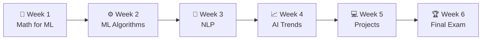

<div align="center">

# 🧠 AI & Machine Learning Course
### Taught in Amharic · አማርኛ

**Learn • Build • Apply**

*Learn AI in your own language.*

<br>


<br>

**Instructor:** Wongel Dawit — Researcher, Language and Spatial Technologies Lab, CMU-Africa<br>
**Made possible by the partnership with** [CS Made Easy](https://github.com/nethen-ui/CS-Made-Easy-Textbook)

</div>

---

## 🌍 What This Is

This repository is the home of our **AI & Machine Learning Course**: a 6-week program that takes you from the mathematical foundations of machine learning to real, hands-on projects, **taught entirely in Amharic**.

Everything the course produces lives here: lecture slides, notes, practice exercises, project material, and resources. It is **open to everyone**. Whether you are following along live or learning on your own later, you can use these materials.

> [!NOTE]
> This repository is a living project. Materials are added as the course progresses, so check back after every class.

---

## 🤝 Partnership

This course is made possible by the partnership of:

| | Partner | Role |
|---|---|---|
| 💻 | **[CS Made Easy](https://github.com/nethen-ui/CS-Made-Easy-Textbook)** | Student-led coding education initiative in Ethiopia, authors of the *Introduction to Programming with Python* textbook |

---

## 👩‍🏫 Meet Your Instructor

<table>
<tr>
<td>

**Wongel Dawit**<br>
*Researcher, Language and Spatial Technologies Lab, CMU-Africa*

You are learning from a researcher who is actively working and contributing to this field, not just reading about it.

</td>
</tr>
</table>

---

## 🗓️ 6-Week Schedule

Classes run on **Saturdays and Sundays**.



| Week | Topic | What you'll cover | Days |
|:-:|---|---|---|
| **1** | 📐 **Math for ML** | Build the mathematical foundation for machine learning: linear algebra essentials and calculus basics | Sat & Sun |
| **2** | ⚙️ **ML Algorithms & Use Cases** | Learn popular algorithms and where they are used. **Sat:** study different ML algorithms & use cases · **Sun:** practical exercise | Sat & Sun |
| **3** | 📝 **Natural Language Processing (NLP)** | Understand how machines work with human language: NLP concepts and applications | Sat & Sun |
| **4** | 📈 **Current Trends in AI** | Explore the latest developments and real-world impact of AI: key trends and future direction | Sat & Sun |
| **5** | 💻 **Practical Exercise** | Apply what you've learned by building real projects: hands-on project work | Sat & Sun |
| **6** | 🏆 **Final Exam** | Show what you've learned and get certified | Sat & Sun |

---

## 📦 What Is in This Repository

| Folder | What you'll find |
|---|---|
| 📖 **`lectures/`** | Slides and notes for every class |
| 📝 **`assignments/`** | Exercises to reinforce what was taught |
| 🧪 **`notebooks/`** | Hands-on code and practice notebooks |
| 🚀 **`projects/`** | Material for the Week 5 hands-on projects |
| 🔗 **`resources/`** | Recommended reading, videos, and tools |
| 📸 **`photos/`** | Documentation of real class sessions |

<sub>Folder names are a suggested layout. Rename them to match what the repo actually contains.</sub>

---

## 🎯 What You Will Be Able to Do

By the end of this course, you will not just know the vocabulary of AI. You will be able to:

- 📐 Understand the math that machine learning is built on
- ⚙️ Recognize popular ML algorithms and know where each one is used
- 📝 Explain how machines work with human language
- 📈 Follow the latest trends and the real-world impact of AI
- 💻 Build and apply what you've learned in real projects

---

## 🙌 How to Use This Repo

1. **Star** ⭐ this repository so you can find it easily
2. **Clone** it to your computer:
   ```bash
   git clone https://github.com/nethen-ui/AI-Hub.git
   ```
3. **Pull** updates after every class:
   ```bash
   git pull
   ```
4. Work through the lectures, do the exercises, and build something

---

## 📄 License

Course materials are published under the **Creative Commons Attribution-NonCommercial-ShareAlike 4.0 International License (CC BY-NC-SA 4.0)**.

- ✔️ Attribution is required
- ✔️ Non-commercial use only
- ✔️ Any adaptations must carry the same license

---

<div align="center">

*Taught in Amharic, built for learners, and made to open the door to AI for everyone.*

**Learn • Build • Apply 🚀**

</div>
