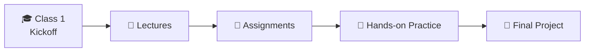

<div align="center">

# 🤖 Introduction to Artificial Intelligence
### Taught in Amharic · አማርኛ

*Learn AI in your own language.*

<br>


<br>

**Instructor:** Wongel Dawit — Researcher, Language and Spatial Technologies Lab, CMU-Africa<br>
**In collaboration with:** Bahir Dar University & CS Made Easy<br>
**Format:** Live classes, in Amharic · Attendance mandatory

</div>

---

## 🌍 What This Is

This repository is the home of our **Introduction to Artificial Intelligence** course: lecture materials, assignments, and resources for a cohort of learners **selected from a pool of 300 applicants**.

The whole course is taught in **Amharic**. AI is shaping the world, and the people building it should not have to learn it in a language that isn't theirs.

> [!NOTE]
> This repository is a living project. Materials are added as the course progresses, so check back after every class.

---

## 👩‍🏫 Meet Your Instructor

<table>
<tr>
<td>

**Wongel Dawit**<br>
*Researcher, Language and Spatial Technologies Lab, CMU-Africa*

You are not learning from someone reading a textbook. You are learning from a researcher who is actively working and contributing to this field. Make the most of it.

</td>
</tr>
</table>

---

## 📜 Course Rules

| | Rule | Details |
|---|---|---|
| ✅ | **Attendance is mandatory** | No class may be missed without prior permission from the admins. |
| 🗣️ | **Language of instruction** | The course is taught in Amharic. If you cannot speak or understand Amharic, DM an admin. |
| 🙋 | **Participation** | Be attentive in class and ask questions whenever you need clarification. |
| 💬 | **Group discipline** | Messages unrelated to the course topic are not allowed in the group. |

> [!IMPORTANT]
> Need permission to miss a class? Contact the admins **before** the class:
> [@n_a_t_h_a_n_w](https://t.me/n_a_t_h_a_n_w) · [@MikiyasShegaw](https://t.me/MikiyasShegaw)

---

## 📦 What Is in This Repository

| Folder | What you'll find |
|---|---|
| 📖 **`lectures/`** | Slides and notes for every class |
| 📝 **`assignments/`** | Exercises to reinforce what was taught |
| 🧪 **`notebooks/`** | Hands-on code and practice notebooks |
| 🔗 **`resources/`** | Recommended reading, videos, and tools |
| 📸 **`photos/`** | Documentation of real class sessions |

<sub>Folder names are a suggested layout. Rename them to match what the repo actually contains.</sub>

---

## 🗓️ Course Roadmap



<details>
<summary><b>📚 Class-by-class schedule (click to expand)</b></summary>

<br>

| Class | Topic | Materials |
|:-:|---|:-:|
| 1 | _Coming soon_ | — |
| 2 | _Coming soon_ | — |
| 3 | _Coming soon_ | — |

</details>

---

## 🎯 What You Will Be Able to Do

By the end of this course, you will not just know the vocabulary of AI. You will be able to:

- 🧠 Understand how AI systems actually work
- 🔍 Break down and analyze real problems with an AI mindset
- 🛠️ Apply core ideas through hands-on practice
- 🌱 Keep learning on your own, in any language

---

## 🤝 How to Use This Repo

1. **Star** ⭐ this repository so you can find it easily
2. **Clone** it to your computer:
   ```bash
   git clone <repository-url>
   ```
3. **Pull** updates after every class:
   ```bash
   git pull
   ```
4. Attend, ask questions, and do the assignments

---

## 📄 License

Course materials are published under the **Creative Commons Attribution-NonCommercial-ShareAlike 4.0 International License (CC BY-NC-SA 4.0)**.

- ✔️ Attribution is required
- ✔️ Non-commercial use only
- ✔️ Any adaptations must carry the same license

---

<div align="center">

*Taught in Amharic, built for learners, and made to open the door to AI for everyone.*

**See you in class! 🚀**

</div>
